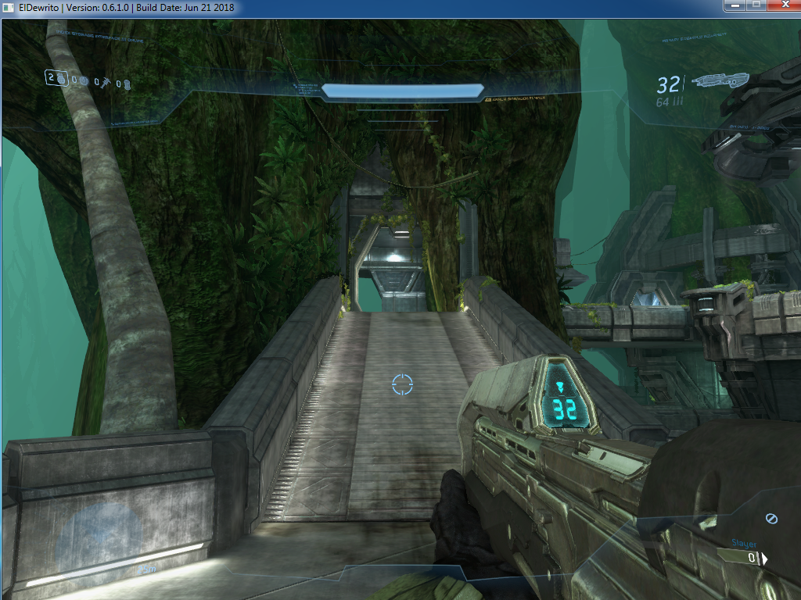

# svga-vgpu

3D acceleration for Windows VMs on an ordinary consumer GPU, with QEMU on Linux.
No GPU passthrough, no second card, no datacenter GPU, no licences.

The guest gets a virtual VMware SVGA II card and uses VMware's own signed
Windows driver. QEMU (with the [qemus/qemu-vmvga](https://github.com/qemus/qemu-vmvga)
device and our fixes) turns the guest's Direct3D commands into real Direct3D 9
calls on [DXVK](https://github.com/doitsujin/dxvk), which runs them as Vulkan on
the host GPU. The host keeps the GPU: the VM is just one more Vulkan program,
like a game under Proton.

**Status (2026-10):** Windows 7 x64 guest, VMware WDDM driver 7.14, host
Radeon RX 7900 (RADV). Aero works. Halo Online (ElDewrito 0.6), a D3D9 game
with deferred lighting, renders a full match at 45–52 fps at 1024×768.



## How it works

```
 Windows guest                         Linux host
┌───────────────────────────┐        ┌──────────────────────────────────────┐
│ game (D3D9)               │        │ QEMU                                 │
│   │                       │        │  vmvga: SVGA3D command translator    │
│ d3d9 runtime              │        │   (+ patches/vmvga/)                 │
│   │                       │        │      │ D3D9 calls                    │
│ w7xum9.dll (our shim) ─┐  │        │  DXVK-native (libdxvk_d3d9.so)       │
│ VMware D3D9 UMD  <─────┘  │ SVGA3D │      │ Vulkan                        │
│ VMware WDDM KMD (signed) ─┼────────┼─>  RADV / any Vulkan driver ──> GPU  │
└───────────────────────────┘ cmds   └──────────────────────────────────────┘
```

More in [docs/how-it-works.md](docs/how-it-works.md).

## What's here

| Path | What |
|---|---|
| `patches/vmvga/` | our fixes to qemu-vmvga v1.03, applied in order by the build |
| `scripts/build.sh` | builds QEMU 11.1.1 + patched vmvga + DXVK-native 2.7.1 into `./build` (user-local) |
| `scripts/vm.sh` | defines/starts a test VM under `qemu:///session` with the vmvga device |
| `scripts/vm-input.sh` | keyboard/mouse/screenshot automation for a libvirt VM |
| `scripts/halo-test.sh` | an automated Halo Online test run (login, launch, match, screenshots) |
| `guest/umd-shim/` | our D3D9 user-mode driver shim for the guest: adds vendor formats games need (FOURCC `NULL`, DXT/ATI volume textures) in front of VMware's UMD |
| `tools/` | debugging: frame-dump → PNG, a D3D9 shader disassembler, a profile report |
| `docs/` | how it works, guest setup, the fixes, debugging, performance |

## Quick start

Host: Linux with KVM, libvirt (user session), a Vulkan GPU, and the build
dependencies of QEMU, DXVK (meson, ninja, glslang) and SPICE.

```sh
# The VMware guest driver needs the VMware backdoor port.
echo 'options kvm enable_vmware_backdoor=Y' | sudo tee /etc/modprobe.d/kvm-vmware-backdoor.conf
# (reload the kvm modules or reboot)

scripts/build.sh                          # QEMU + vmvga + DXVK into ./build
VM_DISK=win7.qcow2 scripts/vm.sh start    # your own Windows 7 disk image
scripts/vm.sh view
```

Then install the guest driver and our shim: [docs/guest-setup.md](docs/guest-setup.md).

## Limits

- D3D9-class rendering; vmvga's D3D10/11 path (VGPU10) is not where this
  work has gone yet.
- Slower than passthrough. Nothing is saturated at 45–52 fps; guest and
  host currently take turns (see [docs/performance.md](docs/performance.md)).
- The host keeps a CPU-side copy of most guest surfaces: plan for up to
  `VMVGA_SURFACE_MB` (default 2048) of extra host RAM.
- Tested with one guest OS, one driver version, one GPU, mainly one game.

## Legal

Scripts, tools, the guest shim and the docs are under the MIT licence
([LICENSE](LICENSE)). The patches in `patches/vmvga/` modify qemu-vmvga and
are under GPL-2.0-or-later ([patches/vmvga/LICENSE.md](patches/vmvga/LICENSE.md)).
The build downloads QEMU (GPLv2) and DXVK (zlib) from their upstream sources.
No third-party binaries are included: you supply your own Windows and the
VMware guest driver. Details: [THIRD-PARTY.md](THIRD-PARTY.md).
